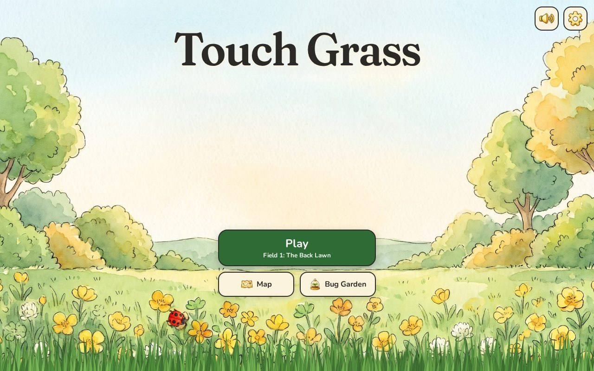
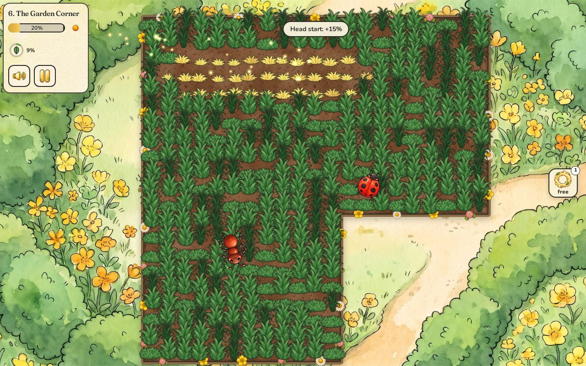
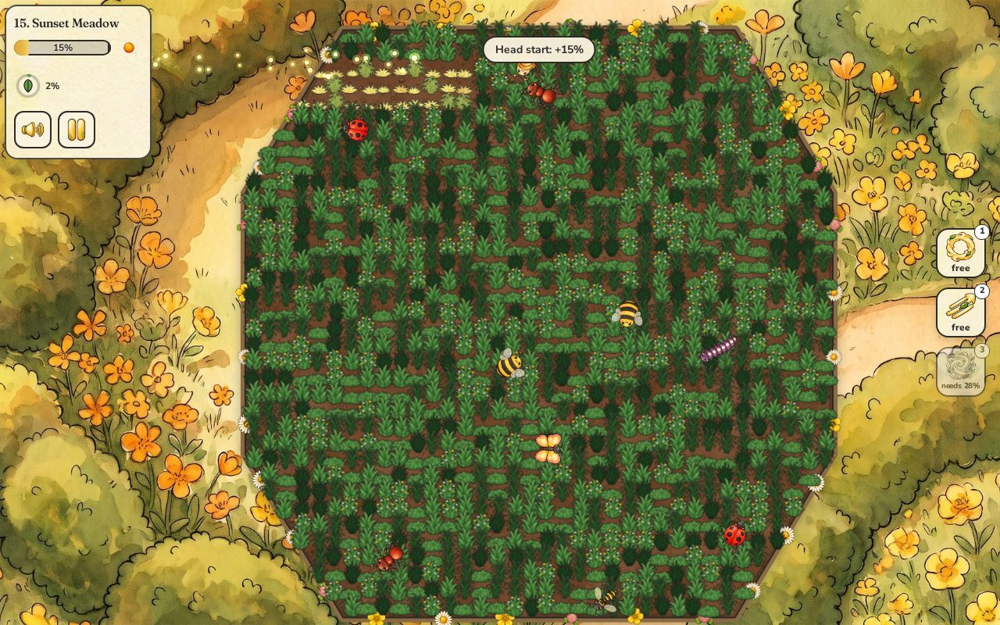
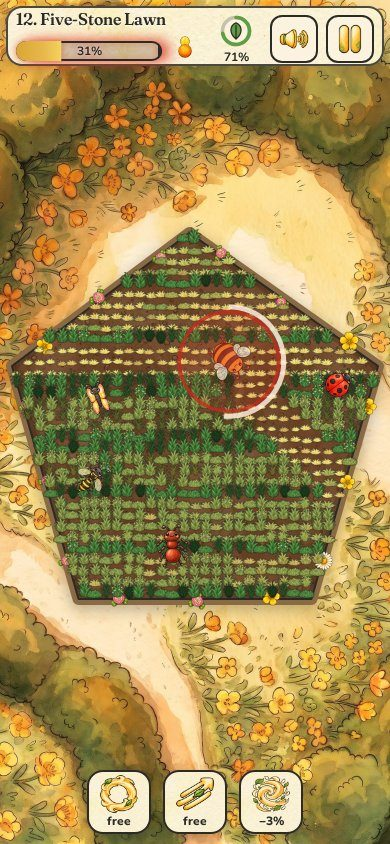
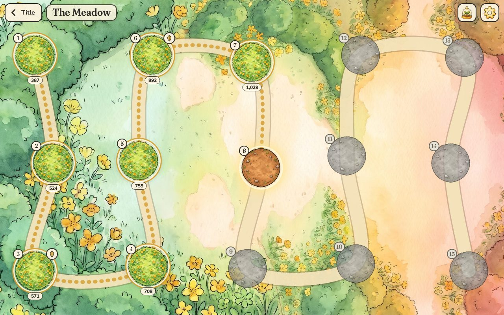
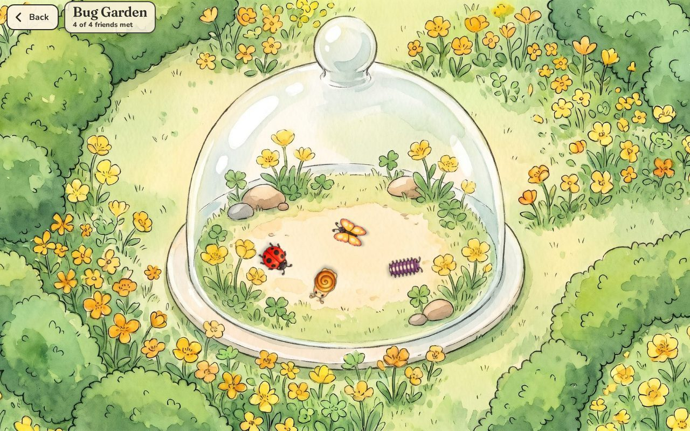
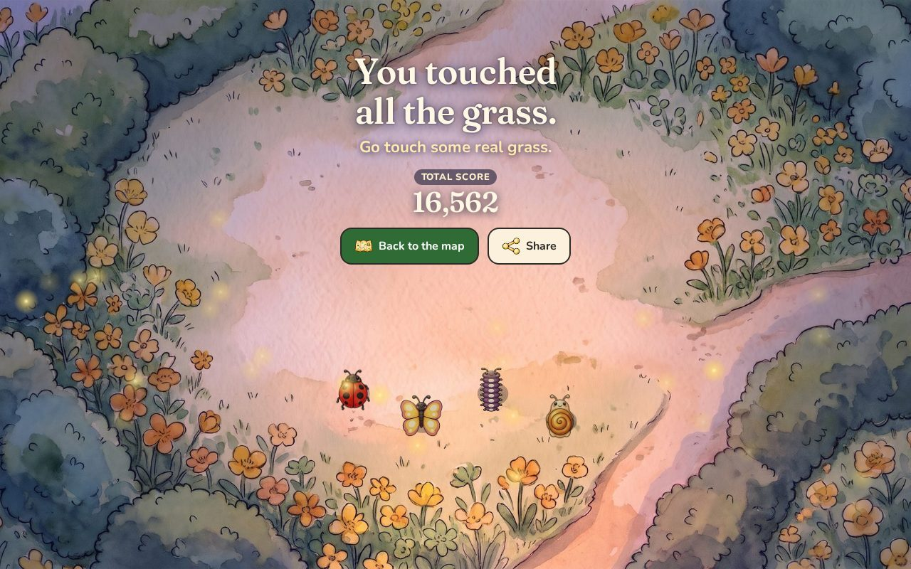

# Touch Grass

*Run your hand through the meadow.*

Sweep a finger or mouse through a sunlit field and the grass bends, flattens and turns gold under your
touch, then slowly grows back. Fill the meter and the field blooms, opening the next one, across fifteen
fields from morning to sunset. On the way you meet the bugs who live there: grumpy ants, bees and wasps
that glow red before they nip, and friendly ladybugs, butterflies, caterpillars and snails you can say
hello to and collect in your Bug Garden. No timer you can fail, no game over.

**[▶ Play Touch Grass](https://touchgrass.synapticnoise.com/)** in your browser. No install, works on
desktop and on phones.

## The meadow

Fifteen fields in one summer day: squares, L-shapes, a cross, a pentagon, two islands and an octagon,
each with its own mix of grass and its own bugs.

| | |
|---|---|
|  |  |
| **Morning to golden hour.** Each time of day has its own painted surroundings and music. | **Five kinds of grass.** Tall grass is worth more, short grass springs back fast, stiff grass needs a second stroke. |
|  |  |
| **Grumpy bugs** glow red and get grumpier each time you pass. Steer away, or they nip a little energy. | **The meadow map.** Replay any field for a better score or to touch every blade. |
|  |  |
| **The Bug Garden.** Every friend you say hello to comes to live under the jar. | **The ending,** at dusk, with every friend you met. |

## How to play

- **Sweep:** drag across the field: hold the mouse button and move, or drag one finger. Standing grass
  gives energy; the gold trail shows where you've been.
- **Say hello:** click or tap a ladybug, butterfly, caterpillar or snail.
- **Moves** (from field 6): **Ring** calms grumpy bugs in a circle, **Line** flattens stiff grass in one
  stroke, **Full Clear** touches every blade at once. Arm one from the toolbar (or press 1, 2, 3), then
  press the field. A move sweeps the grass it covers and costs about what that grass is worth.
- **Pause:** Esc or P, or the pause button. **Mute:** M, or the speaker button.
- On a phone, hold it either way up. You can install it from your browser's menu to play full screen,
  even offline.
- Found a bug? Pause and pick "Report a bug", or press Ctrl+Shift+F (you'll need a GitHub account).

Fill the meter to finish a field. Touch every blade before it fills and the next field starts with a
head start. You can't lose: a nip takes a little energy and the field carries on. Your progress, best
scores, Bug Garden and settings are saved in your browser.

## How it was made

Touch Grass is Rich Conlan's game: planned by Rich, who built its first title screen, then finished by
[Claude Code](https://claude.com/claude-code) with [gamegen](https://github.com/zeveck/gamegen), keeping
Rich's design (the sweep, regrowth, energy, fifteen shaped fields, grass types, three moves, seven bugs, the
collection, scores and sharing) and reworking the numbers, the look and the screens. The original plan is
in [`plans/touch-grass.md`](plans/touch-grass.md).

It was finished from these requests, in this folder:

> `--plan-only --share-design --finish --leeway some`

> "The folder we're in. That's what I'd expect calling it like this to do."

> "then --in-place, yes"

That made a reviewed design, shared for comments with a few mock pictures, on a `gamegen-finish` branch.

> `--plans`

That put the plan on the [plans page](https://synapticnoise.com/plans/).

> `--continue --feedback on --no-confirm --publish --art-sheet --budget 30`

And that built it, with a "Report a bug" button, and published it.

gamegen surveyed the original, wrote the design (in [`design/`](design/)), had a player, a builder and an
art-and-sound director review it twice, simulated the pacing of every field, made the art and sound,
built it in milestones, play-tested every field and screen at desktop and phone sizes, and ran a final
playtest, bug hunt and polish review. The art and sound came from these plugins:

- [imagegen2](https://github.com/zeveck/imagegen2): the bugs (with separate wings that flap), the seven
  grass tufts the game bends and tints, the move and menu icons, flowers, map patches and the app icon.
- [nanogen](https://github.com/zeveck/nanogen): the painted meadows for morning, afternoon, golden hour
  and dusk, the title, the meadow map, the Bug Garden, and the soil and paper textures.
- [anim8gen](https://github.com/zeveck/anim8gen): the ladybug's crawl on the title and in the Bug Garden.
- [audiogen](https://github.com/zeveck/audiogen): four songs in D major, the meadow and dusk ambience,
  the grass rustle that follows your finger, the buzz, the nip, the chirp and the moves' sounds. The
  chimes and bells are played by the game itself, so they're always in tune.

## Replaying the tests

The game's simulation runs in Node as well as the browser. `node tools/solve-all.mjs` plays every field
with fast, average, calm and scribbling players at phone and desktop sizes and checks that each one wins
(its results are in [`design/tuning/tuned.md`](design/tuning/tuned.md)). `bash scripts/test-all.sh` runs
the unit tests and the browser tests (`npm ci` and `npx playwright install chromium webkit` first).

## Playing locally

Touch Grass is a plain web page with no build step. Serve the `game` folder with any static web server,
for example:

    cd game
    python3 -m http.server 8000

then open http://localhost:8000. (Browsers won't run it opened straight from the file.)

## Credits

- Idea, design and first build: Rich Conlan.
- Fonts: [Fraunces](https://github.com/undercasetype/Fraunces) and [Nunito](https://github.com/googlefonts/nunitofont),
  both under the SIL Open Font License (`game/fonts/`).
- "Report a bug" form: [gh-feedback](https://github.com/zeveck/gh-feedback).
